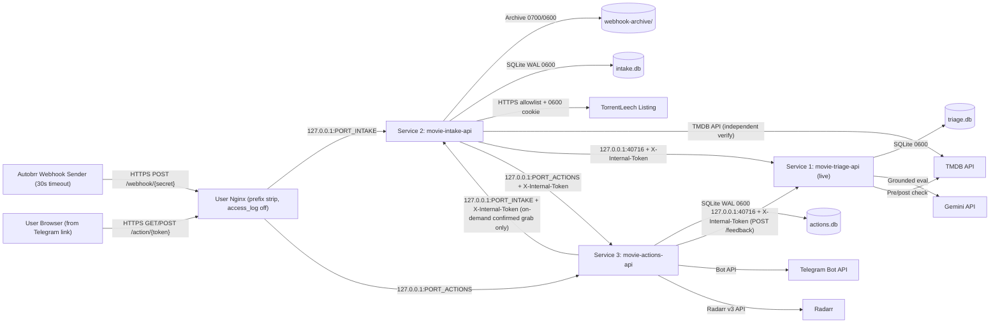
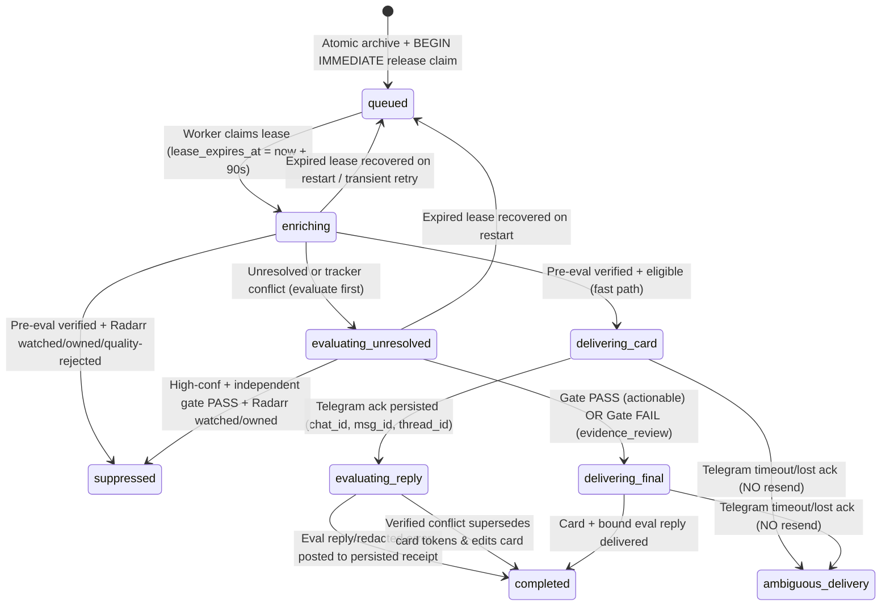

# `movie-intel` Clean Microservice Architecture

> Target architecture for replacing the legacy `movie-intel` monolith (`~/radarr-festival-list`, baseline `89e7f99`) with a lean, local-only, 3-service Python FastAPI suite on Ultra.cc (non-root userland systemd), anchored strictly to [`docs/LEGACY_HANDOVER.md`](LEGACY_HANDOVER.md) and [`AGENTS.md`](../AGENTS.md).

---

## 1. Design Principles & Scope Boundary

1. **Lean Footprint (3 Cohesive FastAPI Services):** Respect Ultra.cc shared-seedbox RAM, process, and port budgets by consolidating into three tightly scoped services rather than over-fragmenting.
2. **Strict Least-Privilege Secret Isolation:** Each service holds **only** the credentials required for its own boundary. No raw tracker cookies, passkeys, `download_url` tokens, webhook secrets, action tokens, or API keys ever cross into SQLite records, LLM prompts, Telegram messages, logs, error strings, or Git.
3. **Shared-Seedbox Multi-Tenant Loopback Defense:** Because Ultra.cc is a shared multi-tenant Linux host where other local accounts can reach `127.0.0.1:<PORT>`, every internal service-to-service endpoint is authenticated with an owner-only `INTERNAL_API_SECRET` (`chmod 600`, constant-time `hmac.compare_digest` via `X-Internal-Token`), with optional `0600` Unix domain socket transport inside a `0700` runtime directory.
4. **Zero Legacy Bloat:** Nothing on the [Drop List](#9-explicit-drop-list--migration-boundary) is ported. Existing legacy systemd units remain untouched during architecture review and shadow verification.
5. **Deterministic Invariants Over Implicit Behavior:** Three distinct identities (`occurrence`, `release`, `action`), archive-before-filter durability, durable SQLite WAL work queues, independent identity verification before actionable links, write-ahead journaling before irreversible external writes, and explicit reconciliation on ambiguous timeouts.

---

## 2. Service Topology & Secret Isolation



### 2.1 Service Inventory & Privilege Matrix

| Service | Deploy Path & Unit | Binding | Held Secrets (Per-Service `chmod 600` `.env`) | State & Files Owned | Explicitly Forbidden Access |
|---|---|---|---|---|---|
| **1. `movie-triage-api`** *(live)* | `~/apps/movie-triage-api/`<br>`movie-triage-api.service` | `127.0.0.1:40716` | `GEMINI_API_KEY`, `TMDB_API_KEY`, `INTERNAL_API_SECRET` *(follow-up hardening)* | `~/apps/movie-triage-api/data/triage.db`, `taste_profile.txt` | Webhook secret, TL cookies, raw archive, `download_url`, Radarr key, Telegram bot token |
| **2. `movie-intake-api`** *(new)* | `~/apps/movie-intake-api/`<br>`movie-intake-api.service` | `127.0.0.1:<PORT_INTAKE>` *(from `app-ports free` + `ss -tlnp` check)* | `MOVIE_INTEL_WEBHOOK_SECRET`, `MOVIE_INTEL_TL_COOKIE_FILE`, `TMDB_API_TOKEN`, `INTERNAL_API_SECRET` | Private webhook archive (`~/.local/state/movie-intel/webhook-archive/`), `intake.db`, `intake-tmdb-cache.json` | `GEMINI_API_KEY`, `RADARR_API_KEY`, `TELEGRAM_BOT_TOKEN`, `MOVIE_INTEL_ALTERNATIVE_GRAB_CONFIG`, direct Radarr/Telegram/qBittorrent writes |
| **3. `movie-actions-api`** *(new)* | `~/apps/movie-actions-api/`<br>`movie-actions-api.service` | `127.0.0.1:<PORT_ACTIONS>` *(from `app-ports free` + `ss -tlnp` check)* | `RADARR_API_KEY`, `TELEGRAM_BOT_TOKEN`, `MOVIE_INTEL_ALTERNATIVE_GRAB_CONFIG`, `INTERNAL_API_SECRET` | `actions.db` (deliveries, hashed action tokens, write-ahead journal), Alternative Grab receipt state dir (`0700`/`0600`) | Webhook secret, TL cookies, `GEMINI_API_KEY`, direct raw archive filesystem access, persistent storage of `download_url` |

### 2.2 Authoritative Ownership Matrix

Every production invariant has **exactly one** authoritative owner:

| Concern | Authoritative Owner | Enforced Invariant |
|---|---|---|
| **Raw webhook archive persistence** | `movie-intake-api` | Every complete valid JSON delivery (duplicates + non-movies) is written atomically (`0700`/`0600`) **before** business filtering. Failed required archive write returns HTTP `503`. |
| **Burst deduplication & work coalescing** | `movie-intake-api` | Durable SQLite WAL (`BEGIN IMMEDIATE`) claim on `(indexer, external_id, exact_release_name)`. Retains every `occurrence_id` separately. Never collapses distinct encodes, editions, or trackers by title/year or IMDb ID. |
| **TorrentLeech listing scraping & cooldowns** | `movie-intake-api` | Single serialized worker, `O_RDONLY \| O_NOFOLLOW \| O_NONBLOCK` + `fstat` cookie validation, canonical HTTPS numeric allowlist with redirects disabled, heading match + freeleech badge strip, persistent `Retry-After` cooldowns. |
| **Independent identity verification gate** | `movie-intake-api` *(primary)* + `movie-actions-api` *(defense-in-depth)* | Evaluates title/year, independent IMDb↔TMDB movie lookup agreement, actual MediaInfo runtime vs TMDB runtime, and local conflict checks. `movie-actions-api` refuses to mint ordinary `add_grab`/`watched_*` links unless `identity_gate_status == "verified"` and `tmdb_id` is verified. |
| **LLM evaluation, taste profile & feedback store** | `movie-triage-api` | Reuses existing `/health`, `POST /evaluate`, `POST /feedback`, `GET /feedback`, `GET /recent`. `WATCH` is strictly a recommendation, never an automatic grab. |
| **Pre-delivery suppression decision** | `movie-intake-api` *(using read-only Radarr status from `movie-actions-api`)* | Suppresses exact `watched`+unmonitored matches, routine already-owned (`hasFile == true` outside eligible Alternative Grab), and routine quality-rejected/non-upgrade releases before any Telegram send. |
| **On-demand `download_url` resolution** | `movie-intake-api` *(read)* → `movie-actions-api` *(ephemeral push)* | `download_url` / passkey is NEVER stored in SQLite. Resolved in memory from the verified `0600` raw archive file (`archive_sha256` checked) ONLY during confirmed `POST /action/{token}` push. |
| **All Radarr reads & irreversible Radarr writes** | `movie-actions-api` | Sole holder of `RADARR_API_KEY`. Write-ahead `attempting` journal committed before external mutation; live root/profile/tag resolution; strict push approval check; watched read-back verification; ambiguous outcome reconciliation. |
| **All Telegram sends, edits, replies & receipts** | `movie-actions-api` | Sole holder of `TELEGRAM_BOT_TOKEN`. Persists exact `(chat_id, message_id, message_thread_id)` receipts; UTF-16 length budgeting; HTML escaping; poster→text fallback without re-evaluating; `.txt` attachment for long reports; `ambiguous_delivery` lock against blind resends. |
| **Expiring opaque action tokens & `/feedback` writes** | `movie-actions-api` | Only SHA-256 token digests stored in `actions.db`; `GET` = private confirmation page only; `POST` = only mutating path; Good/Bad share one watched completion lock; `/feedback` failures are isolated from completed Radarr mutations. |

---

## 3. Three Distinct Identities & SQLite Schemas

Both `intake.db` and `actions.db` run in SQLite `WAL` mode (`journal_mode=WAL`, `synchronous=FULL`, `foreign_keys=ON`, `busy_timeout=5000`), created inside `0700` directories with file permissions `0600` (`UMask=0077`).

### 3.1 Identity Separation

1. **Occurrence (`occurrence_id`, UUIDv7):** One immutable record per valid incoming webhook delivery. Preserves exact raw archive reference (`archive_relpath`, `archive_sha256`), receipt timestamp, and event classification. Duplicate bursts create multiple `occurrences` rows pointing to one `release_id`.
2. **Release (`release_id`, UUIDv7):** One durable work item per unique tracker announcement, uniquely correlated by:
   ```text
   release_key = (normalized_indexer, normalized_external_id, exact_release_name)
   ```
   - `normalized_indexer`: lowercased, trimmed `data.indexer` (e.g. `torrentleech`).
   - `normalized_external_id`: trimmed `data.release.external_id` (empty string `""` only when tracker omits an external ID).
   - `exact_release_name`: exact whitespace-trimmed `data.release.name` preserving resolution, HDR/DV tags, edition tags, and release group (case-sensitive or exact raw string).
   - **Non-collapse guarantee:** Two releases with the same movie title, year, or IMDb ID from different trackers, different encodes (`Remux-2160p` vs `Remux-1080p`), different editions (`Theatrical` vs `Directors.Cut`), different release groups (`CiNEPHiLES` vs `FraMeSToR`), or different tracker `external_id`s **always** get separate `release_id`s.
3. **Action (`action_id`, UUIDv7):** One expiring, single-purpose authorization bound to `(release_id, card_revision, bound_tmdb_id, bound_imdb_id, action_type, expires_at)`. Stored by `token_sha256` only.

### 3.2 `intake.db` Schema (`movie-intake-api`)

```sql
CREATE TABLE occurrences (
    occurrence_id        TEXT PRIMARY KEY,
    received_at          TEXT NOT NULL,
    archive_relpath      TEXT NOT NULL UNIQUE,   -- relative to WEBHOOK_ARCHIVE_DIR (0600 file)
    archive_sha256       TEXT NOT NULL,          -- hex SHA-256 of raw persisted bytes
    payload_bytes        INTEGER NOT NULL,
    classification       TEXT NOT NULL,          -- movie_candidate | movie_category_type_conflict | non_movie_archive_only
    diagnostic_note      TEXT,                   -- sanitized diagnostic (no URLs/secrets)
    release_id           TEXT REFERENCES releases(release_id)
);

CREATE TABLE releases (
    release_id                 TEXT PRIMARY KEY,
    indexer_norm               TEXT NOT NULL,
    external_id_norm           TEXT NOT NULL,
    exact_release_name         TEXT NOT NULL,
    first_occurrence_id        TEXT NOT NULL,
    latest_occurrence_id       TEXT NOT NULL,
    source_occurrence_id       TEXT NOT NULL,    -- occurrence whose archive provides confirmed push payload
    card_revision              INTEGER NOT NULL DEFAULT 0,
    state                      TEXT NOT NULL,    -- queued | enriching | evaluating | delivering | completed | suppressed | ambiguous_delivery | failed_terminal
    suppression_reason         TEXT,             -- watched_unmonitored | unmonitored_no_file | already_owned | quality_rejected | null
    lease_owner                TEXT,
    lease_expires_at           TEXT,
    retry_count                INTEGER NOT NULL DEFAULT 0,
    next_attempt_at            TEXT,
    incoming_evidence_digest   TEXT NOT NULL,    -- SHA-256 of sanitized incoming hints + rejection flags
    full_evidence_digest       TEXT,             -- SHA-256 including TL metadata + MediaInfo
    last_evaluated_digest      TEXT,             -- detects changed evidence requiring force_refresh=true
    tl_outcome                 TEXT,             -- not_applicable | listing_id_found | listing_id_missing | listing_id_malformed | listing_id_conflict | listing_mismatch | login_required | listing_temporary_http | cooldown_active
    identity_gate_status       TEXT NOT NULL DEFAULT 'pending', -- pending | verified | evidence_review
    identity_conflict_reason   TEXT,
    verified_tmdb_id           INTEGER,
    verified_imdb_id           TEXT,
    verified_title             TEXT,
    verified_year              INTEGER,
    radarr_status_snapshot     TEXT,             -- JSON: sanitized read-only Radarr check outcome (no keys/URLs)
    evaluation_json            TEXT,             -- JSON: sanitized movie-triage-api response (no secrets)
    created_at                 TEXT NOT NULL,
    updated_at                 TEXT NOT NULL,
    UNIQUE(indexer_norm, external_id_norm, exact_release_name)
);

CREATE TABLE tl_cooldown (
    singleton_id         INTEGER PRIMARY KEY CHECK (singleton_id = 1),
    cooldown_until       TEXT,
    consecutive_failures INTEGER NOT NULL DEFAULT 0,
    last_reason          TEXT,
    updated_at           TEXT NOT NULL
);

CREATE INDEX idx_releases_queue ON releases(state, next_attempt_at, lease_expires_at);
CREATE INDEX idx_occurrences_release ON occurrences(release_id, received_at);
```

> **Zero-Secret Rule in `intake.db`:** Neither `download_url`, torrent passkeys, cookie values, nor raw webhook payloads are ever stored in `intake.db`. Only `archive_relpath` + `archive_sha256` and sanitized metadata fields are persisted.

### 3.3 `actions.db` Schema (`movie-actions-api`)

```sql
CREATE TABLE deliveries (
    release_id              TEXT PRIMARY KEY,
    card_revision           INTEGER NOT NULL,
    delivery_kind           TEXT NOT NULL,       -- actionable_grab | alternative_grab | evidence_review
    status                  TEXT NOT NULL,       -- sending | delivered | ambiguous_delivery | failed
    process_instance_id     TEXT,                -- UUID of movie-actions-api process owning an active send
    lease_expires_at        TEXT,                -- bounded lease for active Telegram send
    target_chat_id          TEXT NOT NULL,
    target_thread_id        INTEGER,             -- Telegram message_thread_id (topic)
    ack_chat_id             TEXT,                -- strictly populated from Telegram API response
    ack_message_id          INTEGER,             -- strictly populated from Telegram API response
    ack_thread_id           INTEGER,             -- strictly populated from Telegram API response
    used_poster             INTEGER NOT NULL DEFAULT 0,
    eval_reply_status       TEXT NOT NULL DEFAULT 'pending', -- pending | sending | sent | ambiguous_reply | skipped
    eval_reply_message_id   INTEGER,
    eval_doc_message_id     INTEGER,
    last_error_redacted     TEXT,
    created_at              TEXT NOT NULL,
    updated_at              TEXT NOT NULL
);

CREATE TABLE actions (
    action_id               TEXT PRIMARY KEY,
    token_sha256            TEXT NOT NULL UNIQUE, -- hex SHA-256 of opaque URL token; raw token NEVER stored
    release_id              TEXT NOT NULL REFERENCES deliveries(release_id),
    card_revision           INTEGER NOT NULL,
    source_occurrence_id    TEXT NOT NULL,        -- forwarded to intake-service only on confirmed grab
    action_type             TEXT NOT NULL,        -- add_grab | alternative_grab | watched_good | watched_bad | watched_legacy_unrated | skip
    completion_group        TEXT NOT NULL,        -- shared key for watched_good & watched_bad (e.g. "watched:<release_id>:<tmdb_id>")
    bound_tmdb_id           INTEGER,              -- required for add_grab, alternative_grab, watched_*
    bound_imdb_id           TEXT,
    bound_title             TEXT NOT NULL,
    bound_year              INTEGER,
    bound_release_name      TEXT NOT NULL,
    bound_existing_movie_id INTEGER,              -- required for alternative_grab revalidation
    bound_existing_file_id  INTEGER,              -- required for alternative_grab revalidation
    bound_rejection_class   TEXT,                 -- required for alternative_grab revalidation
    status                  TEXT NOT NULL,        -- active | superseded | expired | attempting | ambiguous_radarr | completed_radarr | completed_all | rejected_push
    radarr_movie_id         INTEGER,
    last_reconciled_at      TEXT,
    feedback_status         TEXT NOT NULL DEFAULT 'not_applicable', -- not_applicable | pending | saved | failed
    feedback_decision_saved TEXT,                 -- populated ONLY on matching evaluator ack
    expires_at              TEXT NOT NULL,
    created_at              TEXT NOT NULL,
    updated_at              TEXT NOT NULL
);

CREATE TABLE write_attempts (
    attempt_id              TEXT PRIMARY KEY,
    action_id               TEXT NOT NULL REFERENCES actions(action_id),
    completion_group        TEXT NOT NULL,
    phase                   TEXT NOT NULL,        -- radarr_add_movie | radarr_release_push | radarr_watched | radarr_skip | evaluator_feedback
    status                  TEXT NOT NULL,        -- attempting | succeeded | failed_definitive | ambiguous
    process_instance_id     TEXT NOT NULL,        -- UUID generated at movie-actions-api startup
    lease_expires_at        TEXT NOT NULL,        -- now + upstream_http_timeout + 30s
    request_fingerprint     TEXT NOT NULL,        -- sanitized parameters (root_folder, quality_profile_id, tmdb_id — NO downloadUrl)
    outcome_summary         TEXT,                 -- sanitized Radarr/evaluator status
    started_at              TEXT NOT NULL,
    finished_at             TEXT
);

CREATE INDEX idx_actions_group ON actions(completion_group, status);
CREATE INDEX idx_actions_release_rev ON actions(release_id, card_revision);
CREATE INDEX idx_attempts_action ON write_attempts(action_id, started_at);
CREATE INDEX idx_attempts_status ON write_attempts(status, lease_expires_at);
```

---

## 4. HTTP / JSON API Contracts

### 4.1 Internal Authentication & Transport Security

- **All `/internal/*` and `/replay` routes** require `X-Internal-Token: <INTERNAL_API_SECRET>`, validated with `hmac.compare_digest` (missing/invalid → `401 Unauthorized`).
- **Nginx NEVER routes `/internal/*` or `/replay`**; those paths exist exclusively on loopback `127.0.0.1:<PORT>` (and optionally over `0600` Unix domain sockets inside `~/.local/state/movie-intel/run/` (`0700`) for zero-TCP local IPC).
- **Access logging hygiene:** Both Nginx (`access_log off;`) and FastAPI/uvicorn custom log filters redact `/webhook/{secret}` → `/webhook/[REDACTED]` and `/action/{token}` → `/action/[REDACTED]`, and scrub query strings / passkey-bearing URLs from all structured logs and exception traces.

### 4.2 `movie-intake-api` Endpoints

| Method & Path | Exposure | Purpose & Contract |
|---|---|---|
| `POST /webhook/{secret}` | Public via Nginx *(prefix stripped, `access_log off`)* | Autobrr webhook receiver:<br>• Missing configured `MOVIE_INTEL_WEBHOOK_SECRET` → `503`<br>• Wrong secret (constant-time compare) → `404`<br>• Body > `1,000,000` bytes (enforced via `Content-Length` AND streaming byte cap) → `413`<br>• Invalid JSON or non-standard `NaN`/`Infinity` or non-object root → `400`<br>• Atomic private archive write (`0700`/`0600`, `fsync` + `os.replace`) **before** filtering; write failure → `503`<br>• Atomic SQLite `BEGIN IMMEDIATE` occurrence insert + release claim/attach → `200 OK` (`{"status": "accepted"\|"coalesced_duplicate"\|"archived_non_movie", "occurrence_id": "...", "release_id": "..."}`) well within autobrr's 30s timeout. |
| `GET /health` | Loopback only | Returns `{"status": "ok", "port": ..., "queued_releases": N, "tl_cooldown_active": bool, "archive_dir_ok": bool}` (zero secret data). |
| `POST /internal/releases/{release_id}/push-payload` | Loopback + `X-Internal-Token` | Called **only** by `movie-actions-api` during confirmed `Add & Grab` / `Alternative Grab`. Body: `{"source_occurrence_id": "..."}`. Opens the `0600` archive file (`O_RDONLY \| O_NOFOLLOW`), validates `fstat` ownership/mode and `SHA-256 == archive_sha256`, extracts ONLY the Radarr `/api/v3/release/push` fields (`title`, `downloadUrl`, `protocol`, `publishDate`, `indexer`, `indexerId`, `size`) in memory, and responds with `Cache-Control: no-store`. Never logs response body. |
| `POST /internal/replay` | Loopback + `X-Internal-Token` *(shadow mode only)* | Feeds a sanitized archive file or fixture through the real intake pipeline in shadow mode (stubbed external writers, zero mutations). Disabled by default in production (`SHADOW_REPLAY_ENABLED=false`). |

### 4.3 `movie-actions-api` Endpoints

| Method & Path | Exposure | Purpose & Contract |
|---|---|---|
| `GET /action/{token}` | Public via Nginx *(prefix stripped, `access_log off`)* | Private read-only confirmation HTML page (`Cache-Control: no-store`, `Referrer-Policy: no-referrer`, `X-Frame-Options: DENY`). Never mutates Radarr or `/feedback`. Reads live Radarr root folders, quality profiles, exact movie/file state (and for `alternative_grab`, revalidates existing movie/file + rejection class). Renders explicit POST form or idempotent completion/conflict status. |
| `POST /action/{token}` | Public via Nginx *(prefix stripped, `access_log off`)* | **Only mutating path.** Validates token hash + expiry + `completion_group` lock + explicit form parameters. Executes write-ahead journal, live Radarr validation & write (or reconciliation if prior attempt was `ambiguous_radarr`), read-back verification, and isolated `/feedback` post. Returns HTML status page with exact Radarr & feedback outcomes. |
| `GET /internal/radarr/status` | Loopback + `X-Internal-Token` | Read-only pre-delivery lookup: query params `tmdb_id` (optional), `imdb_id` (optional), `release_title` (optional). Returns normalized status: `absent`, `watched_unmonitored`, `owned_file` (with `movie_id`, `file_id`, `existing_quality`), `monitored_no_file` or `unmonitored_no_file` (with `movie_id`), `ambiguous`, or `lookup_failed`. Never assumes absence on `lookup_failed` or `ambiguous`. |
| `POST /internal/deliver/card` | Loopback + `X-Internal-Token` | Sends initial Telegram card (or edits bound card on a higher `card_revision` verified correction). Validates defense-in-depth invariants (refuses ordinary `add_grab`/`watched_*` buttons unless `identity_gate_status == "verified"` and `verified_tmdb_id` is set). Mints opaque tokens (storing only `token_sha256`), routes to configured topic, applies UTF-16 budgeting & HTML escaping, handles poster→text fallback internally, and persists exact Telegram receipt `(ack_chat_id, ack_message_id, ack_thread_id)` or `ambiguous_delivery`. |
| `POST /internal/deliver/evaluation` | Loopback + `X-Internal-Token` | Posts evaluation result or redacted error as a **reply** strictly bound to the persisted `(ack_chat_id, ack_message_id, ack_thread_id)`. Rejects if delivery is `ambiguous_delivery` or lacks a persisted `ack_message_id` (never guesses destination!). Attaches long details as a private `.txt` document. |
| `GET /health` | Loopback only | Returns `{"status": "ok", "port": ..., "pending_ambiguous_deliveries": N, "pending_ambiguous_radarr": N}`. |

### 4.4 `movie-triage-api` Contract (Existing Live Service + Small Follow-Up Hardening)

Reused as-is from `127.0.0.1:40716`:
- `GET /health`
- `POST /evaluate` — receives `raw_text` (exact release name), optional `hint_title`, `hint_year`, `extra_context`, `force_refresh`, and `torrent_info` (`indexer`, `category`, `imdb_id`, `tmdb_id`, `runtime_minutes` = **actual MediaInfo file duration only**, `audio_languages` = **audio tracks only, never subtitles**, `resolution`, `source`, `dynamic_range`, `media_processing`, `group`, `size_gb` = decimal GB, `freeleech` = explicit `true`/`false` when known, sanitized `description`, sanitized `nfo_text`; **omit unknown fields**).
- `POST /feedback` — sends `{title, imdb_id, tmdb_id, decision: "watch"|"skip", note}`. Note: `movie-triage-api` normalizes `decision` to uppercase `"WATCH"`/`"SKIP"` in `FeedbackResponse`; `movie-actions-api` validates `response.status == "saved"` **and** `response.decision.lower() == expected_decision.lower()` before reporting a saved rating.
- `GET /feedback`, `GET /recent`.

**Cache-bypass invariant & small follow-up PR on `movie-triage-api`:**
- Currently `movie-triage-api`'s SQLite cache key hashes `(raw_text, hint_title, hint_year, extra_context, quality_key)` and does **not** include `torrent_info` identity/MediaInfo fields.
- **Immediate rule in `movie-intake-api`:** Compute `full_evidence_digest` across `raw_text`, hints, and all populated `torrent_info` fields. Pass `force_refresh: true` whenever (a) `torrent_info` carries identity/MediaInfo/conflict evidence that `movie-triage-api`'s cache key cannot distinguish from an earlier call, or (b) `full_evidence_digest != last_evaluated_digest` on a re-evaluation / correction.
- **Small follow-up PR on `movie-triage-api` (separate from cutover blockers, low risk):**
  1. Add optional `INTERNAL_API_SECRET` (`X-Internal-Token`) verification on `POST /evaluate`, `POST /feedback`, `GET /feedback`, `GET /recent` to close shared-loopback abuse on Ultra.cc.
  2. Include a canonical `torrent_info` evidence digest in `triage.db`'s cache key alongside `quality_key` so safe cache hits work cleanly while never serving stale evaluations across changed evidence.

---

## 5. End-to-End Processing Pipeline & State Machines

### 5.1 Intake, Coalescing & Restart-Safe Worker Lifecycle (`movie-intake-api`)



#### Step-by-Step Guarantees

1. **Receive, Authenticate & Archive Before Filtering:**
   - Validate webhook secret, body size (`<= 1,000,000` bytes), strict JSON (reject `NaN`/`Infinity`).
   - Persist exact raw bytes atomically to `~/.local/state/movie-intel/webhook-archive/YYYY/MM/DD/<utc_ts>_<occurrence_id>.json` (`0700` dirs, `0600` file, `fsync` + `os.replace`).
   - Classify payload by inspecting `action.rejected`, `data.result.rejections`, `data.release` (`type`, `title`, `year`, `name`, `category`), and `data.indexer`:
     - Non-movie, announce, IRC, feed, or housekeeping payloads → insert `occurrences(classification='non_movie_archive_only')`, return `200 OK`, stop.
     - Movie category with conflicting non-movie `data.release.type` → insert `occurrences(classification='movie_category_type_conflict')` + structured diagnostic log only, return `200 OK`, stop.
     - Valid movie candidate → inside one `BEGIN IMMEDIATE` transaction, `INSERT OR IGNORE` into `releases` on `(indexer_norm, external_id_norm, exact_release_name)` and insert `occurrences` linked to `release_id`.
2. **Burst Coalescing, Late Arrivals & Corrections:**
   - **Simultaneous burst (2–8s apart) & late duplicates:** `UNIQUE(indexer_norm, external_id_norm, exact_release_name)` guarantees exactly one `releases` row is created; subsequent deliveries attach their own `occurrence_id` and compare `incoming_evidence_digest`:
     - Unchanged evidence → no requeue, no second scrape, no second evaluation, no duplicate Telegram card.
     - Materially changed evidence (e.g., corrected hints or updated rejection status on a newer delivery) → update `latest_occurrence_id` & `incoming_evidence_digest`, bump `card_revision`, and re-queue for re-verification (never downgrading an already-verified identity with a failed/unverified lookup, and never reopening a release whose Radarr action is already `completed_radarr`/`completed_all`).
   - **Restart recovery:** On startup (and periodically every 30s), the worker loop reclaims rows in `enriching`/`evaluating` whose `lease_expires_at < now`, resuming cleanly without creating duplicate releases or resending already-delivered cards (`deliveries` is keyed by `release_id`).
3. **Routine Quality Rejection Early Check:**
   - Inspect `action.rejected` and `data.result.rejections`.
   - If `action.rejected == true`:
     - If `data.result.rejections` consists exclusively of known routine quality / non-upgrade rejection classes (e.g., cutoff met, lower quality, unwanted quality/profile mismatch):
       - Check whether the webhook satisfies the exact legacy Alternative Grab source & 4-form Radarr rejection rules (TorrentLeech movie, Radarr action, valid title/year, no season/episode, release name `<= 512`, numeric `external_id`, canonical HTTPS TL download URL bound to `external_id`, 1–8 reasons all matching one of the 4 allowed legacy forms) **and** query `movie-actions-api` `GET /internal/capabilities` for `alternative_grab_configured == true` (`movie-intake-api` never reads `MOVIE_INTEL_ALTERNATIVE_GRAB_CONFIG` because it holds qBittorrent credentials).
       - If NOT eligible or Alternative Grab is not configured → suppress early as `suppressed (quality_rejected)` before any Telegram send (skipping expensive TL scraping / Gemini evaluation).
       - If eligible and configured → continue to enrichment, Independent Identity Verification Gate, and live Radarr check so the exception is strictly bound to an exact verified monitored existing movie/file snapshot (never an identity conflict; rejected `evidence_review` cards route to `TELEGRAM_GRAB_ANYWAY_TOPIC_ID` with 0 buttons).
     - If `data.result.rejections` is empty, ambiguous, or indicates an existing-movie/unknown error → continue to identity verification and live Radarr status lookup so `watched_unmonitored`, `unmonitored_no_file`, `already_owned`, `monitored_no_file`, and genuine identity conflicts are distinguished accurately.
4. **TorrentLeech Enrichment (Serialized Single Worker):**
   - Runs only when `MOVIE_INTEL_TL_METADATA_ENABLED=true`, `indexer_norm == "torrentleech"`, and `external_id_norm` matches `^[1-9][0-9]{0,19}$`.
   - **Cookie file loading:** Open configured absolute `MOVIE_INTEL_TL_COOKIE_FILE` with `os.open(path, os.O_RDONLY | os.O_NOFOLLOW | os.O_NONBLOCK)`. Check `os.fstat(fd)`: regular file (`S_ISREG`), `st_uid == os.getuid()`, `(st_mode & 0o077) == 0`, `st_size <= 16384`. Read from `fd` only (no TOCTOU). Reject any symlink or unsafe permission with a redacted error (`login_required`/config error).
   - **Canonical URL & transport:** Fetch ONLY `https://www.torrentleech.org/torrent/{external_id}` (`^https://www\.torrentleech\.org/torrent/[1-9][0-9]{0,19}$`), `follow_redirects=False`, bounded connect/read timeout (10s/15s), streaming body cap `<= 1,000,000` bytes. Never fetch `download_url`.
   - **Cooldowns:** Single serialized worker checks `tl_cooldown` in `intake.db` first; if `cooldown_until > now`, immediately record `cooldown_active` without hitting TorrentLeech. On `429`/`5xx`/rate-limit, honor `Retry-After` (or exponential backoff) and persist `tl_cooldown` in SQLite so restarts honor cooldowns.
   - **HTML verification & distinct outcomes:**
     - Detect login HTML even on HTTP `200` (and on `3xx` redirects to login) → `login_required`.
     - Extract all release headings (`#torrentnameid`, `#torrentName`, etc.); strip **only** the known freeleech badge (`span.new.label.labelfreeleech` / `FREELEECH`) and normalize whitespace. **Every** heading must match `exact_release_name`; any mismatch or missing heading → `listing_mismatch` (discard all scraped metadata).
     - Inspect all IMDb fields and links on the verified listing: single valid `tt\d{7,10}` → `listing_id_found`; none → `listing_id_missing`; invalid syntax → `listing_id_malformed`; two differing IMDb IDs → `listing_id_conflict`.
     - Extract sanitized NFO/MediaInfo and description (stripping any secret/passkey URLs), keeping **actual MediaInfo file duration** (`General → Duration`) separate from catalogue runtime and **Audio track languages** separate from `Text`/subtitle languages.

### 5.2 Independent Identity Verification Gate

Neither tracker hints (`meta_imdb`, `meta_tmdb`, TL listing IMDb) nor evaluator proposals (`movie-triage-api`) may attach ordinary `Add & Grab` or `Add as Watched` buttons until **all** independent checks pass in `movie-intake-api`:

| Check | Pass Requirement | Failure Outcome |
|---|---|---|
| **1. Source / TL integrity** | If TL lookup was required for this release, `tl_outcome` is NOT a failure (`login_required`, `listing_mismatch`, `listing_temporary_http`, `cooldown_active`) and NOT `listing_id_conflict` / `listing_id_malformed`. | Failed TL lookup **cannot** authorize a title-only guess → `evidence_review`. |
| **2. Confidence & canonical IDs** | For evaluator proposals: `match_confidence == "high"`. Valid `imdb_id` (`tt\d{7,10}`) and positive integer `tmdb_id` present. | `medium`/`low` confidence or missing verified IDs → `evidence_review`. |
| **3. Independent IMDb↔TMDB agreement** | `movie-intake-api` queries TMDB directly (`TMDB_API_TOKEN`, cached in `TMDB_CACHE_PATH`): `/3/movie/{tmdb_id}` (with `external_ids`) confirms it is a **movie** whose `imdb_id` matches, AND `/3/find/{imdb_id}?external_source=imdb_id` returns the exact same `tmdb_id` without multi-movie ambiguity. | Disagreement, TV/non-movie entity, or TMDB lookup failure → `evidence_review`. |
| **4. Release title & year match** | Parsed title from `exact_release_name` matches TMDB `title`, `original_title`, or `alternative_titles` (normalized token/transliteration check). Release year (when present in filename) is within `±1` year of TMDB release year. | Title mismatch or `\|release_year - tmdb_year\| >= 2` → `evidence_review`. |
| **5. Actual MediaInfo runtime check** | When actual file duration (`runtime_minutes` from MediaInfo/NFO) AND TMDB runtime are both known: `\|file_runtime - tmdb_runtime\| <= max(12, 0.12 * tmdb_runtime)` (strictly using file duration, never catalogue runtime). | Runtime mismatch → `evidence_review` (and flags conflict to evaluator). |
| **6. Local conflict check** | Zero unresolved conflicts across autobrr hints (`meta_imdb`/`meta_tmdb`), verified TL listing IMDb, and Radarr library matches. Specifically, if a tracker supplied an explicit IMDb/TMDB ID that **conflicts** with the release title/year/runtime or another source, that is a **genuine identity conflict**. | Genuine identity conflict → `evidence_review` only (NEVER converted to ordinary buttons or "Grab Anyway"). |

### 5.3 Pre-Delivery Radarr Suppression Matrix

Once a movie identity is independently verified (either pre-evaluation on the fast path, or post-evaluation when an unidentified movie passes the gate), `movie-intake-api` calls `GET /internal/radarr/status` on `movie-actions-api`:

| Radarr Status | Release Eligibility | Action Taken |
|---|---|---|
| `watched_unmonitored` (`watched` tag present AND `monitored == false`) | Exact verified match | **Suppress before delivery** (`suppressed: watched_unmonitored`). Zero Telegram send; zero Gemini call if detected pre-evaluation. |
| `owned_file` (`hasFile == true`, not watched+unmonitored) | Routine release (no Alternative Grab match, or `monitored == false`) | **Suppress before delivery** (`suppressed: already_owned`). Zero Telegram send. |
| `owned_file` (`hasFile == true`, `monitored == true`) | `movie-actions-api` has valid `MOVIE_INTEL_ALTERNATIVE_GRAB_CONFIG`, release matches exact legacy TorrentLeech + 4-form Radarr rejection rules, AND no identity conflict | Deliver **Alternative Grab** card to `TELEGRAM_GRAB_ANYWAY_TOPIC_ID`, bound to exact 9-field live Radarr movie/file snapshot + evaluation reply. |
| `unmonitored_no_file` (unmonitored, no file, no `watched` tag) | Exact verified match | Suppress before delivery and record `unmonitored_no_file`. A pre-evaluation match also skips Gemini. |
| `monitored_no_file` (`monitored == true`, `hasFile == false`, no `watched` tag) | Verified release | **Do NOT suppress** (monitoring alone proves neither ownership nor viewing). Deliver actionable card explicitly labeled `"Monitored in Radarr (no file yet)"` + evaluation reply. |
| `absent` (confirmed live Radarr check returned zero matching movies) | Verified release | Deliver actionable card to `TELEGRAM_ADD_GRAB_TOPIC_ID` (fallback `TELEGRAM_TOPIC_ID`) with `Add & Grab`, `Watched – Good`, `Watched – Bad` (and optional `Skip`) + evaluation reply. |
| `lookup_failed` or `ambiguous` (Radarr unreachable, timeout, or ambiguous match) | Any | **Do NOT treat as absent.** Do NOT silently suppress or mint unchecked grab assumptions. Deliver `evidence_review` card (or deferred/warning notice clearly stating Radarr status could not be verified) + evaluation reply. |
| *Unresolved / Identity Conflict* (`identity_gate_status == "evidence_review"`) | Any | Never suppress via guessed Radarr lookup; never mint Alternative Grab buttons. Deliver `evidence_review` card (0 buttons; shows observed evidence & conflict summary) to `TELEGRAM_TOPIC_ID` (or `TELEGRAM_GRAB_ANYWAY_TOPIC_ID` when an eligible rejected release fails verification) + evaluation/redacted error reply. |

### 5.4 Two-Phase Prompt Delivery, Formatting & Replies (`movie-actions-api`)

1. **Prompt Card Delivery + Bound Evaluation Reply:**
   - **Fast path (pre-evaluation verified):** Deliver the actionable Telegram card immediately (< 2s after webhook), persist Telegram's exact `(ack_chat_id, ack_message_id, ack_thread_id)`, then call `movie-triage-api POST /evaluate` and deliver the evaluation summary (or redacted error) as a reply to that exact `(ack_chat_id, ack_message_id, ack_thread_id)`.
   - **Unresolved / conflicted path:** Evaluate first (so `movie-triage-api` can attempt resolution and so newly verified watched/owned movies are still suppressed before delivery), run the independent verification gate + Radarr check, then deliver either the verified actionable card or the `evidence_review` card and immediately post the evaluation (or redacted error) as a reply to its persisted `(ack_chat_id, ack_message_id, ack_thread_id)`.
   - **Newer verified correction wins:** If a later occurrence or retry produces a higher-trust verified correction for an already-delivered `release_id` (and no irreversible Radarr write has completed), `movie-actions-api` marks prior active tokens `superseded`, mints fresh tokens for `card_revision + 1`, edits the bound message using persisted `(ack_chat_id, ack_message_id, ack_thread_id)`, and replies with the updated evaluation (`force_refresh: true`).
2. **Telegram Limits & Fallback Rules:**
   - Escape all untrusted text via `html.escape(text, quote=True)`.
   - Enforce Telegram's **UTF-16 code-unit limits** (`len(text.encode("utf-16-le")) // 2`): `<= 1,024` units for photo captions and `<= 4,096` units for text messages (accurately counting non-BMP characters/emoji as 2 units each, never slicing inside HTML tags, entities, or surrogate pairs).
   - **Poster → Text fallback:** If `sendPhoto` fails definitively (e.g., HTTP 400 invalid image/caption, poster fetch error), immediately fall back to `sendMessage` inside the **same** `/internal/deliver/card` call, preserving the exact inline button keyboard. Poster failure **never** re-queues or repeats `/evaluate`.
   - **Long evaluation details:** If the formatted evaluation exceeds the 4,096 UTF-16 unit budget, post a compact summary reply within budget and upload the full sanitized evaluation as a private `.txt` document (`sendDocument`) replying to the same `(ack_chat_id, ack_message_id, ack_thread_id)`.
3. **Lost Telegram Acknowledgment (`ambiguous_delivery`):**
   - `deliveries` row is committed with `status = 'sending'` **before** calling Telegram.
   - If Telegram returns a definitive error proving non-delivery (e.g., connection refused before send, Telegram `400`/`403` JSON), status becomes `failed` (or falls back from photo to text).
   - If the HTTP request times out or disconnects **after transmission** (acknowledgment lost): status becomes `ambiguous_delivery` (`ack_message_id = NULL`).
   - **Hard invariants:** Never resend a possibly delivered grab card; never guess a `message_id`, `chat_id`, or topic for edits/replies; `/internal/deliver/evaluation` refuses to send an unanchored reply when `ack_message_id IS NULL`.

---

## 6. Telegram Actions, Write-Ahead Journaling & Reconciliation (`movie-actions-api`)

### 6.1 Confirmation Flow (`GET` vs `POST`)

- **`GET /action/{token}`:** Read-only private HTML confirmation page. Validates `SHA-256(token)`, expiry, and current action status. Fetches live Radarr root folders, quality profiles, and exact movie state. Zero side effects. When an action (or its `completion_group`) is in `ambiguous_radarr`, renders an explicit reconciliation status view with a read-only-until-confirmed `<form method="POST">` button (`"Re-check Radarr Status & Reconcile"`).
- **`POST /action/{token}`:** Only mutating path. Serializes concurrent submissions via SQLite `BEGIN IMMEDIATE` on `actions` + `completion_group`:
  - Unknown / superseded token → `404` / `410` (redacted).
  - Expired token (`now > expires_at`) when `status == 'active'` → `410 Gone` (refuses to initiate any new mutation). Once an action has already been initiated (`attempting`, `ambiguous_radarr`, `completed_radarr`, `completed_all`), `GET`/`POST` remains permitted strictly for status inspection, Radarr reconciliation, and isolated `/feedback` retry (never initiating a new Grab/Watched after expiry).
  - Already `completed_radarr` / `completed_all` → returns idempotent completion page (zero external Radarr writes!). If `feedback_status == 'failed'`, offers an isolated **Retry Evaluator Feedback Only** button that never touches Radarr.
  - A sibling Skip in `attempting`, `ambiguous_radarr`, `completed_radarr`, or `completed_all` blocks Add & Grab and Alternative Grab for the same release. Add & Grab also rejects an existing unmonitored movie.
  - Active in-flight attempt (`attempting` with `process_instance_id == current_process_instance_id` AND `lease_expires_at > now`) in the same `completion_group` → `409 Conflict` ("Action already in progress").
  - Orphaned or expired-lease attempt (`attempting` with `process_instance_id != current_process_instance_id` OR `lease_expires_at <= now`) → atomically promoted to `write_attempts.status = 'ambiguous'` and `actions.status = 'ambiguous_radarr'` (see [§6.4](#64-restart--orphaned-attempt-recovery-movie-actions-api)) and routed straight into **Reconciliation** (never stranded on `409`).
  - Prior `ambiguous_radarr` (on the action itself or a sibling in the same `completion_group`) → runs **Reconciliation** ([§6.3](#63-ambiguous-outcome-reconciliation--feedback-isolation)) before permitting any new external write.

### 6.2 Action Semantics

| Action Type | Pre-Write Checks | Write-Ahead & Radarr / qBittorrent Operation | Post-Action Feedback (`movie-triage-api`) |
|---|---|---|---|
| **`Add & Grab`** (`add_grab`) | Validate chosen root folder & quality profile against live Radarr; lookup `/api/v3/movie?tmdbId={bound_tmdb_id}`; fetch ephemeral push payload from `movie-intake-api` (`POST /internal/releases/{release_id}/push-payload`) in memory. *(If any pre-write check fails, abort cleanly before `attempting`.)* | **Two explicit write-ahead phases** (neither stores `downloadUrl`):<br>1. *(Only if movie absent)* Commit `write_attempts(phase='radarr_add_movie', status='attempting', process_instance_id, lease_expires_at)`, then `POST /api/v3/movie` (`monitored: true, addOptions: {searchForMovie: false}`), and record `radarr_movie_id`.<br>2. Commit `write_attempts(phase='radarr_release_push', status='attempting', process_instance_id, lease_expires_at)`, then `POST /api/v3/release/push` with **only the announced release**. Require **exact single decision** (`len == 1`) with `approved === true` and `rejected === false` (HTTP `200` alone is insufficient!). | Only after confirmed acceptance: `POST /feedback` with `{title, imdb_id, tmdb_id, decision: "watch", note: "Grabbed via Telegram"}`. Verify `status == "saved"` & `decision.upper() == "WATCH"`. |
| **`Alternative Grab`** (`alternative_grab`, optional via actions-only `MOVIE_INTEL_ALTERNATIVE_GRAB_CONFIG`) | Revalidate exact 9-field live Radarr movie/file snapshot (monitored, `file_id`, profile, path, edition, group, size, quality), single enabled HTTPS qBittorrent client in Radarr matching configured endpoint + `movieCategory`, and durable `0600` receipt **both before and after** fetching the bound canonical HTTPS TorrentLeech `.torrent` bytes (`<= 4 MB`, `follow_redirects=False`, strict v1 bencode SHA-1 info hash). Open a fresh HTTPS qBittorrent session (never reusing tracker cookies) and verify not already present, category exists, and autorun hooks disabled. | **Zero Radarr writes.** Commit `qbit_alt_preflight` → durable `0600` receipt keyed to `external_id` → atomic handoff to `qbit_alternative_grab` → submit ONE multipart `POST /api/v2/torrents/add` with validated `.torrent` bytes and fixed `category` ONLY (no `urls`, no pause/start overrides), followed by bounded read-only `torrents/info` verification. Lost acks transition to `uncertain` (`ambiguous_radarr`) and reconcile read-only without duplicate adds. | **None** (matches legacy behavior: zero `/feedback` writes on Alternative Grab). |
| **`Add as Watched – Good / Bad`** (`watched_good`, `watched_bad`) | Acquire **shared `completion_group`** lock (`watched:<release_id>:<tmdb_id>`) so Good and Bad share a single watched completion. Resolve `watched` tag ID dynamically from live `/api/v3/tag` by label (no hardcoded tag ID). | Commit `write_attempts(phase='radarr_watched', status='attempting', process_instance_id, lease_expires_at)`. Add unmonitored (`monitored: false`, `searchForMovie: false`, `tags: [watched_tag_id]`) OR update existing movie adding `watched_tag_id`, setting `monitored: false`, preserving all existing tags and existing files. **Mandatory read-back:** `GET /api/v3/movie/{id}` and assert BOTH `watched_tag_id in tags` AND `monitored === false`. No search, no push. | Good → `decision: "watch"`; Bad → `decision: "skip"`; both `note: "watched"`. Older unrated watched links send **no** feedback. Report "Rating saved" **only** on matching `status == "saved"` + matching `decision` ack. |
| **Standalone Skip** (`skip`, enabled via `MOVIE_INTEL_STANDALONE_SKIP_ENABLED`) | Confirm by explicit POST. Verify bound movie identity. For an add, validate the live root folder and quality profile. | Journal `radarr_skip`. Add an absent movie with `monitored=false`, `tags=[]`, and `searchForMovie=false`. For an existing monitored movie, update only `monitored` via the editor. Preserve existing tags and files. Read back the movie by ID even if already unmonitored. | After verified read-back, seal at `completed_radarr` and send `decision="skip"`, `note="Skipped via Telegram"`. |

### 6.3 Ambiguous Outcome Reconciliation & Feedback Isolation

- **Pre-transmit vs ambiguous failures:** Only a definitive pre-transmit transport failure (local DNS failure or TCP `ConnectionRefusedError` before any HTTP request bytes are sent) marks an attempt `failed_definitive` (`not_transmitted`) and returns `actions.status` to `active`. Any write/read timeout, mid-stream disconnect, ambiguous HTTP `5xx`, or process crash after committing `attempting` transitions the attempt to `ambiguous` and the action to `ambiguous_radarr`.
- **Ambiguous Phase 1 (`radarr_add_movie`, pre-push):** Because `phase == 'radarr_release_push'` has **never** been entered and `searchForMovie` is `false`, reconciliation queries `GET /api/v3/movie?tmdbId={bound_tmdb_id}`:
  1. If the movie now exists → mark `radarr_add_movie` succeeded and record `radarr_movie_id`. If `now <= expires_at`, re-fetch the ephemeral push payload in memory from `movie-intake-api` (`POST /internal/releases/{release_id}/push-payload`) and proceed to Phase 2 (`radarr_release_push`); if expired, stop cleanly (`expired`) without pushing.
  2. If absent → if `now > expires_at`, mark `expired` without mutating Radarr; otherwise revalidate root folder & quality profile against live Radarr and retry `POST /api/v3/movie` (`searchForMovie: false`). If a delayed original `POST` wins the race and returns HTTP `400` ("already exists" on unique `tmdbId`), re-read `GET /api/v3/movie?tmdbId={bound_tmdb_id}`, re-fetch the ephemeral push payload in memory, and reuse the movie before proceeding to Phase 2.
- **Ambiguous Phase 2 (`radarr_release_push`, non-idempotent acquisition):** Because Radarr's `/api/v3/release/push` has no client idempotency key and an unacknowledged request may **still be executing** inside Radarr:
  1. Query live Radarr `/api/v3/movie?tmdbId={bound_tmdb_id}`, `/api/v3/queue/details?movieId={id}`, and `/api/v3/history/movie?movieId={id}` matching the announced release title/guid within the attempt window (also checking whether a newly imported file on the movie matches the announced release).
  2. **Match FOUND in queue, grab history, or imported file:** The original push succeeded! Transition `write_attempts.status = 'succeeded'`, `actions.status = 'completed_radarr'` (zero second push!), and execute ONLY the pending isolated `/feedback` call.
  3. **Match NOT FOUND in queue/history (absent snapshot):** An absent snapshot **does NOT prove** the original `/api/v3/release/push` finished without acceptance — the delayed original request may still complete and appear in queue/history seconds later. Therefore, **`movie-actions-api` MUST retain `actions.status = 'ambiguous_radarr'` and MUST NOT issue a second `/api/v3/release/push`.** Update `last_reconciled_at` and render a clear status page offering only a read-only **"Re-check Radarr Status"** action. If the delayed original push subsequently completes and appears in queue/history, the next re-check transitions cleanly to `completed_radarr` + isolated `/feedback` with **exactly 1 push total**. (No automatic second push is ever permitted once `radarr_release_push` may have been transmitted; if an operator confirms out-of-band in Radarr that the push never landed, they resolve it directly in Radarr rather than bypassing the single-push invariant.)
  4. **Radarr unreachable during reconciliation:** Stay `ambiguous_radarr` (`503`), zero writes.
- **Ambiguous Radarr Watched (`radarr_watched`, idempotent desired-state mutation):** On reconciliation (including when a sibling in the same `completion_group` is `ambiguous_radarr`), `GET /api/v3/movie?tmdbId={bound_tmdb_id}` and resolve the live `watched` tag ID:
  1. If movie exists with BOTH `watched` tag AND `monitored === false` → seal the original attempt/action as `completed_radarr` (preventing duplicate writes from a sibling Good/Bad link) and execute only the pending rated `/feedback` call.
  2. If movie exists partially updated (e.g., added without tag or still monitored) → apply idempotent `PUT` preserving files and existing tags, then verify mandatory read-back (`watched` tag AND `monitored === false`).
  3. If movie is absent → retry unmonitored `POST /api/v3/movie` (`monitored: false`, `searchForMovie: false`, `tags: [watched_tag_id]`); if a delayed original `POST` wins the race with HTTP `400` ("already exists" on unique `tmdbId`), re-read `GET /api/v3/movie?tmdbId=...`, apply idempotent `PUT` if needed, and verify mandatory read-back.
- **Ambiguous Skip** (`radarr_skip`). Reconcile against the authoritative movie by ID. A verified unmonitored movie proceeds to isolated feedback. Retry the monitoring update if needed. If the movie is absent after expiry, return 410.
- **Feedback Failure Isolation:** Once `actions.status` reaches `completed_radarr`, the Radarr step is **permanently sealed**. A `502`/`504`/network error or restart during `phase == 'evaluator_feedback'` sets `feedback_status = 'failed'`, reports honestly to the user that Radarr succeeded while evaluator feedback did not save, and **never** undoes or repeats the Radarr mutation.

### 6.4 Restart & Orphaned-Attempt Recovery (`movie-actions-api`)

At process startup, `movie-actions-api` generates a fresh `process_instance_id` (UUID) and runs a synchronous SQLite `BEGIN IMMEDIATE` recovery sweep inside FastAPI's `lifespan` **before** accepting HTTP traffic:

1. **Orphaned `write_attempts` (`status = 'attempting'` and `process_instance_id != current_process_instance_id`):**
   - Mark `write_attempts.status = 'ambiguous'`, `outcome_summary = 'orphaned_attempt_after_process_restart'`, `finished_at = now`.
   - For `phase IN ('radarr_add_movie', 'radarr_release_push', 'radarr_watched', 'radarr_skip', 'qbit_alt_preflight', 'qbit_alternative_grab')`: transition parent `actions.status` from `'attempting'` → `'ambiguous_radarr'`, so the next `GET` shows reconciliation status and `POST` enters [§6.3](#63-ambiguous-outcome-reconciliation--feedback-isolation) instead of returning `409 Conflict` indefinitely.
   - For `phase == 'evaluator_feedback'`: leave `actions.status = 'completed_radarr'` intact and mark `feedback_status = 'failed'` (eligible for isolated feedback-only retry without touching Radarr).
2. **Orphaned `deliveries` (`status = 'sending'` or `eval_reply_status = 'sending'` with `process_instance_id != current_process_instance_id`):**
   - Transition `deliveries.status` → `'ambiguous_delivery'` (`last_error_redacted = 'orphaned_send_after_process_restart'`), preserving the no-blind-resend invariant.
   - Transition `deliveries.eval_reply_status` → `'ambiguous_reply'`.
3. **Runtime stale-lease safeguard:** Even without a process restart, if a handler wedges beyond `lease_expires_at` (`now + upstream_http_timeout + 30s`), the next `BEGIN IMMEDIATE` check promotes the expired `attempting` row to `ambiguous_radarr` and enters reconciliation rather than stranding the action on `409`.

---

## 7. Ultra.cc Non-Root Deployment & Configuration Plan

### 7.1 Port Allocation & Non-Root Systemd Units

- **No `sudo`, no root paths, no Docker.** All units live in `~/.config/systemd/user/`.
- Existing live units (untouched during build & shadow testing):
  - `movie-intel.service` (`~/radarr-festival-list`, `127.0.0.1:40714`)
  - `movie-triage-api.service` (`~/apps/movie-triage-api/`, `127.0.0.1:40716`)
- New units (`movie-intake-api.service`, `movie-actions-api.service`):
  - Select two unassigned ports via `app-ports free` **and** cross-verify against `ss -tlnp` + `~/.config/systemd/user/*.{service,socket}` (preventing collisions with ports already bound by user units).
  - Bind strictly to `127.0.0.1:<PORT_INTAKE>` and `127.0.0.1:<PORT_ACTIONS>`.
  - Systemd user unit hardening: `UMask=0077`, `NoNewPrivileges=true`, `Restart=on-failure`, `RestartSec=5`.
  - Directory & file permissions enforced at startup (service refuses to start if unsafe): state & archive directories `0700`, `.env` / SQLite / cookie files `0600`.

### 7.2 Operator Environment Variables & Absolute Path Validation

Existing operator variable names from `~/.config/movie-intel/environment` are preserved, sliced into per-service least-privilege `chmod 600` `.env` files so neither service inherits credentials it does not own. **All configured path overrides must be absolute paths** (services fail fast at startup on relative paths or unexpanded `~`).

- **`~/apps/movie-intake-api/.env` (`0600`):**
  - `MOVIE_INTEL_HOST=127.0.0.1`, `MOVIE_INTEL_PORT=<PORT_INTAKE>`
  - `MOVIE_INTEL_WEBHOOK_SECRET`
  - `MOVIE_INTEL_TL_METADATA_ENABLED` (`true`/`false`), `MOVIE_INTEL_TL_COOKIE_FILE` (deployed `/home/<user>/.config/movie-intel/torrentleech-cookies-pr42.json`)
  - `TMDB_API_TOKEN`, `TMDB_CACHE_PATH` (default `/home/<user>/.local/state/movie-intel/intake-tmdb-cache.json` — isolated from legacy `tmdb-cache.json`)
  - `WEBHOOK_ARCHIVE_DIR` (default `/home/<user>/.local/state/movie-intel/webhook-archive`)
  - `INTAKE_DB_PATH` (default `/home/<user>/.local/state/movie-intel/intake.db`)
  - `TRIAGE_API_URL=http://127.0.0.1:40716`, `ACTIONS_API_URL=http://127.0.0.1:<PORT_ACTIONS>`
  - `INTERNAL_API_SECRET`
  - *(Never receives `MOVIE_INTEL_ALTERNATIVE_GRAB_CONFIG`, `RADARR_API_KEY`, `TELEGRAM_BOT_TOKEN`, or `GEMINI_API_KEY`.)*
- **`~/apps/movie-actions-api/.env` (`0600`):**
  - `ACTIONS_HOST=127.0.0.1`, `ACTIONS_PORT=<PORT_ACTIONS>`
  - `MOVIE_INTEL_PUBLIC_BASE_URL` (public HTTPS origin for Telegram action buttons)
  - `RADARR_URL` (preserving any provider prefix), `RADARR_API_KEY`
  - `TELEGRAM_BOT_TOKEN`, `TELEGRAM_CHAT_ID`, `TELEGRAM_TOPIC_ID`, `TELEGRAM_ADD_GRAB_TOPIC_ID`, `TELEGRAM_GRAB_ANYWAY_TOPIC_ID`
  - `MOVIE_INTEL_ACTION_TTL_SECONDS`, `MOVIE_INTEL_ALTERNATIVE_GRAB_CONFIG` (actions-only `0600` qBittorrent config retained active at cutover), `MOVIE_INTEL_STANDALONE_SKIP_ENABLED=true` (enabled alongside `Watched – Good / Bad`)
  - `ACTIONS_DB_PATH` (default `/home/<user>/.local/state/movie-intel/actions.db`)
  - `INTAKE_API_URL=http://127.0.0.1:<PORT_INTAKE>`, `TRIAGE_API_URL=http://127.0.0.1:40716`
  - `INTERNAL_API_SECRET`

*(Op1 Disposition — Previously Issued Legacy JSON Buttons: `movie-actions-api` owns `actions.db` exclusively and does not read or write legacy `MOVIE_INTEL_ACTION_STORE` `~/.local/state/movie-intel/actions.json`. For the already-completed initial cutover, legacy JSON tokens outside `actions.db` intentionally return HTTP `404` rather than bridging legacy mutable JSON state without SQLite write-ahead locks. For any future cutover or rollback/migration window, operators MUST first run a read-only inventory of unexpired legacy tokens (or announce explicit expiry prior to switching Nginx) and, if honoring unexpired tokens is required, deploy a bounded, time-limited read-only import/transition into `actions.db` that preserves exact original confirmation semantics, `Watched – Good` (`watch`) / `Watched – Bad` (`skip`) rating semantics, and single-write idempotency without writing back to `actions.json`.)*

### 7.3 User Nginx Proxy Rules

- Preserve existing prefix stripping so `movie-intake-api` sees `/webhook/{secret}` and `movie-actions-api` sees `/action/{token}`.
- Enforce `client_max_body_size 1m;` on the webhook location and `access_log off;` on **both** `/webhook/` and `/action/` locations so secrets and action tokens never appear in Nginx logs.
- Proxy ONLY `/webhook/` and `/action/`; never expose `/internal/*`, `/replay`, `/health`, `/evaluate`, or `/feedback` publicly.

---

## 8. Shadow Verification Plan & 5 Mandatory Pre-Cutover Test Cases

Before any Nginx or autobrr cutover, `movie-intake-api` and `movie-actions-api` run in **Shadow Verification Mode**:
- Isolated shadow state directory (`~/.local/state/movie-intel-shadow/`, `0700`) and sanitized input fixtures (zero real passkeys, cookies, or download URLs).
- Stubbed external writers for Telegram Bot API, Radarr v3 API, and evaluator `/feedback` (plus controllable TorrentLeech/TMDB/evaluator stubs for deterministic fault injection).
- **Hard Shadow Invariant:** Zero external mutations (0 real Telegram messages, 0 real Radarr writes, 0 real `/feedback` writes).
- **Acceptance Criterion:** Pass/fail is measured strictly against the architectural invariants below — **never** against legacy `movie-intel`'s Telegram send count (since legacy lacked burst deduplication and pre-delivery suppression).

### Mandatory Case 1: Duplicate Burst, Restart Recovery, Late Delivery & Non-Collapse
- **Inputs (sanitized):**
  - *1a (Concurrent burst):* 3 identical autobrr movie webhooks for `(torrentleech, "9001001", "Example.Film.2024.2160p.UHD.BluRay.REMUX.DV.HDR10-CiNEPHiLES")` sent at `t=0s`, `t=2.5s`, and `t=7.0s`.
  - *1b (Mid-flight restart):* 1 webhook claimed into `enriching`/`evaluating`, worker killed before completion, restarted with expired lease.
  - *1c (Late duplicate):* 4th identical webhook for `9001001` sent 20 minutes after `completed`.
  - *1d (Non-collapse):* Separate webhook for the **same movie/IMDb** with different encode/group/ID `(torrentleech, "9001002", "Example.Film.2024.1080p.BluRay.REMUX.AVC-FraMeSToR")` and another from a second tracker `(othertracker, "555", "Example.Film.2024.2160p.UHD.BluRay.REMUX.DV.HDR10-CiNEPHiLES")`.
  - *1e (Verified correction):* Later occurrence for `9001001` delivering updated metadata after an initial `evidence_review` outcome.
- **Assertions:**
  - *1a:* All 3 POSTs return `200 OK` in `< 1s`; 3 distinct raw archive files (`0600`) and 3 `occurrences` rows exist; exactly **1** `releases` row, **1** TL lookup, **1** evaluator call, and **1** Telegram card + **1** evaluation reply.
  - *1b:* Restart recovers lease and finishes with exactly **1** Telegram card (no duplicate send).
  - *1c:* New `occurrence_id` archived & attached to existing `release_id`; **0** new TL lookups, **0** evaluator calls, **0** Telegram sends.
  - *1d:* Produces **3 distinct `release_id`s** total (zero cross-encode/cross-tracker collapse).
  - *1e:* Increments `card_revision`, supersedes prior tokens, edits bound Telegram card via persisted `(ack_chat_id, ack_message_id, ack_thread_id)`, and triggers `force_refresh: true` evaluation reply.

### Mandatory Case 2: Wrong Tracker IMDb (Poisoned Link)
- **Inputs (sanitized):**
  - Release `True.Film.2024.2160p.UHD.BluRay.REMUX-CiNEPHiLES` with MediaInfo file duration `124 min`, audio `["English"]`, subtitles `["English", "French"]`.
  - Autobrr `meta_imdb` and verified TL listing both supply wrong IMDb `tt0099999` pointing to an unrelated 2018 film (`89 min`) in TMDB stub.
  - Evaluator stub identifies `True Film (2024)` (`tt2024999`, `tmdb_id=2024999`, `124 min`) and notes tracker conflict.
- **Assertions:**
  - Raw payload archived (`0600`); TL heading check succeeds; audio (`English`) kept strictly separate from subtitles (`English`, `French`); MediaInfo file duration (`124`) passed distinctly as `torrent_info.runtime_minutes`.
  - Poisoned `tt0099999` fails title/year/runtime checks and is **rejected** (never used to mint Grab/Watched buttons or suppress via wrong Radarr movie).
  - Evaluator receives conflict context with `force_refresh: true`.
  - Local conflict check detects unresolved tracker-vs-candidate identity conflict → **Evidence Review card ONLY** (0 ordinary Grab/Watched links, 0 Alternative Grab / "Grab Anyway" links), plus evaluation reply bound to `(ack_chat_id, ack_message_id, ack_thread_id)`.

### Mandatory Case 3: Unidentified Movie with Usable Evaluator Answer (and Gate Failure Controls)
- **Inputs (sanitized):**
  - *3a (Gate pass):* Release `Festival.Gem.2025.2160p.UHD.BluRay.REMUX.DV-CiNEPHiLES` with no `meta_imdb`/`meta_tmdb`, TL listing verified (`listing_id_missing`, sanitized NFO with MediaInfo `112 min`), TMDB stub confirms `Festival Gem (2025)` (`tt3025001` ↔ `tmdb_id=3025001`, `114 min`), Radarr stub returns `absent`, evaluator stub returns `high` confidence.
  - *3b (Failed TL lookup control):* Same release, except TL stub returns HTTP `200` login HTML (`login_required`) or `503` (`listing_temporary_http`).
  - *3c (Independent check failure control):* Same release with `listing_id_missing`, but evaluator proposes a film whose TMDB runtime is `168 min` (fails MediaInfo runtime check) or returns `match_confidence: "medium"`.
- **Assertions:**
  - *3a:* Independent verification gate (title/year + IMDb↔TMDB agreement + MediaInfo runtime + zero local conflicts) **PASSES** → Radarr check confirms absent → actionable card with ordinary `Add & Grab` and `Watched – Good/Bad` buttons delivered to `TELEGRAM_ADD_GRAB_TOPIC_ID` + evaluation reply bound to persisted receipt.
  - *3b:* Failed TL lookup **cannot** authorize a title-only guess → `identity_gate_status == "evidence_review"`, **0** ordinary Grab/Watched buttons.
  - *3c:* Gate **FAILS** → `evidence_review` card only, **0** ordinary Grab/Watched buttons.

### Mandatory Case 4: Existing Watched Movie (plus Monitored-No-File & Stale Radarr Controls)
- **Inputs (sanitized):**
  - *4a (Watched + unmonitored):* Verified release whose `tmdb_id` exists in Radarr stub with `tags: [watched_tag_id]` and `monitored: false`.
  - *4b (Monitored, no file):* Verified release whose `tmdb_id` exists in Radarr stub with `monitored: true`, `hasFile: false`, no `watched` tag.
  - *4c (Already owned, no Alternative Grab):* Verified release whose `tmdb_id` exists in Radarr stub with `hasFile: true` and `MOVIE_INTEL_ALTERNATIVE_GRAB_CONFIG` does not authorize it.
  - *4d (Stale / failed Radarr lookup):* Verified release while Radarr stub returns HTTP `503` / timeout.
- **Assertions:**
  - *4a:* Archived & recorded as `suppressed (watched_unmonitored)`; **0** Telegram sends; **0** evaluator calls.
  - *4b:* **NOT suppressed**; actionable card delivered clearly indicating `"Monitored in Radarr (no file yet)"`, distinct from owned file, Alternative Grab, and identity conflict.
  - *4c:* Archived & recorded as `suppressed (already_owned)`; **0** Telegram sends.
  - *4d:* Radarr failure does **NOT** establish absence; release is NOT treated as confirmed absent and surfaces unverified Radarr state cleanly (`evidence_review` / Radarr-unavailable status).

### Mandatory Case 5: Lost Radarr / Telegram Acknowledgment, Process-Kill Recovery & Feedback Failure Isolation
- **Inputs & Fault Injections (sanitized):**
  - *5a (Lost Telegram ack):* Telegram stub accepts `sendPhoto`/`sendMessage` then drops connection before returning HTTP response.
  - *5b (Lost Radarr ack + delayed original push):* User submits `POST /action/{token}` for `Add & Grab`. Radarr stub accepts `POST /api/v3/release/push`, drops the HTTP response (timeout), and **delays** recording the grab in queue/history until **after** the first reconciliation read completes. User submits `POST /action/{token}` once while queue/history is still empty, then again after the delayed original push lands in queue/history.
  - *5c (HTTP 200 rejected Radarr push):* Radarr `/api/v3/release/push` returns HTTP `200` with `[{"approved": false, "rejected": true, "rejections": ["Quality cutoff met"]}]`.
  - *5d (Watched Good/Bad shared completion + `/feedback` failure):* Concurrent `POST`s to `watched_good` and `watched_bad` tokens for the same release; Radarr stub succeeds and passes read-back; evaluator `/feedback` stub returns HTTP `502`.
  - *5e (Poster send failure):* Telegram `sendPhoto` stub returns HTTP `400`; `sendMessage` stub returns `200`.
  - *5f (Process kill / restart after committing `attempting`):* Hard-kill `movie-actions-api` immediately after `write_attempts(status='attempting')` is committed to `actions.db` and before the Radarr response is persisted — covering both (i) `radarr_release_push` where Radarr already applied the grab, (ii) `radarr_watched` where Radarr already applied `watched` + `monitored=false`, and (iii) an orphaned `deliveries.status='sending'` — then start a fresh `movie-actions-api` process (new `process_instance_id`) and submit `POST /action/{token}`.
- **Assertions:**
  - *5a:* `deliveries.status == "ambiguous_delivery"`, `ack_message_id IS NULL`; **0** duplicate grab card retries; `/internal/deliver/evaluation` refuses unanchored send.
  - *5b:* `write_attempts(phase='radarr_release_push')` persisted `attempting` before Radarr call, transitioned to `ambiguous_radarr`; **first reconciliation** observes absent queue/history and **retains `ambiguous_radarr` with 0 second pushes** (never treating an absent snapshot as proof of non-acceptance); after the delayed push lands, **second reconciliation** confirms the grab, seals `completed_radarr` with **exactly 1** Radarr push total, and posts `/feedback` once.
  - *5c:* Push is marked `rejected_push` (not accepted); **0** `/feedback` calls; clear rejection shown to user.
  - *5d:* Shared `completion_group` serializes both requests into **exactly 1** Radarr update + **1** read-back check (`watched` tag + `monitored == false`); `/feedback` failure does **NOT** retry or undo Radarr; response confirms Radarr watched succeeded and explicitly states rating was **not** saved (never claims saved without matching ack).
  - *5e:* Falls back to `sendMessage` with identical inline buttons preserved; evaluator is called **exactly once** (never re-queued by poster failure).
  - *5f:* Startup recovery immediately promotes orphaned `attempting` rows (`process_instance_id != current_process_instance_id`) to `ambiguous_radarr` and orphaned `sending` deliveries to `ambiguous_delivery`; subsequent `POST /action/{token}` does **NOT** return `409 Conflict` forever — it reconciles against live Radarr, transitions both applied Grab and applied Watched cases cleanly to `completed_radarr` with **0** duplicate Radarr writes, and runs isolated `/feedback` once.

---

## 9. Explicit Drop List & Migration Boundary

Explicitly **excluded** from the new services (preserved in place in existing projects; **not** disabled during architecture or shadow phases):
- Festival rankings, scoring simulations/calibration, festival feed generation.
- GitHub governance/dispatch automation.
- Library-wide import/sync, watched-list imports, bulk tagging (`movie-list-sync.timer`).
- Research scanner/provider/sandbox (`identity-research.service`, `identity-investigation-scan.timer`).
- Legacy `identity-triage.{socket,service}` sidecar.
- Historical handoff queues, supervised credit/Keychain pilots, one-event capture harnesses, audit ledgers, and Mac-dependent assessment worker.

---

## 10. Confirmed Product Decisions

1. **Standalone Skip** (`MOVIE_INTEL_STANDALONE_SKIP_ENABLED=true`) adds or sets the movie to unmonitored, preserves existing tags, and records `decision=skip` after Radarr verification.
2. **`Alternative Grab` ("Grab Anyway", `MOVIE_INTEL_ALTERNATIVE_GRAB_CONFIG`):** **Retained active at cutover** (strictly quality-only exception bound to exact existing movie/file, original release, and allowed rejection class, routed to `TELEGRAM_GRAB_ANYWAY_TOPIC_ID`, revalidated at confirmation, and never triggered on an identity conflict).
